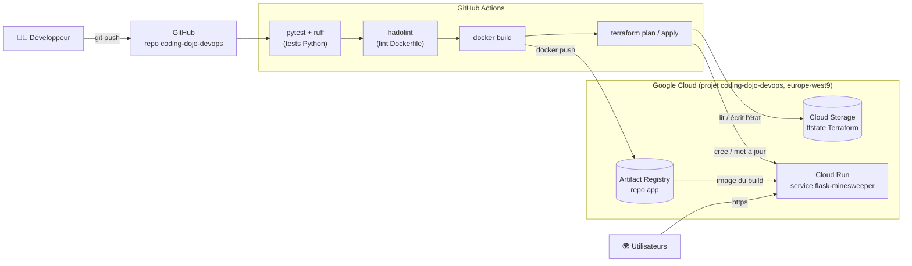
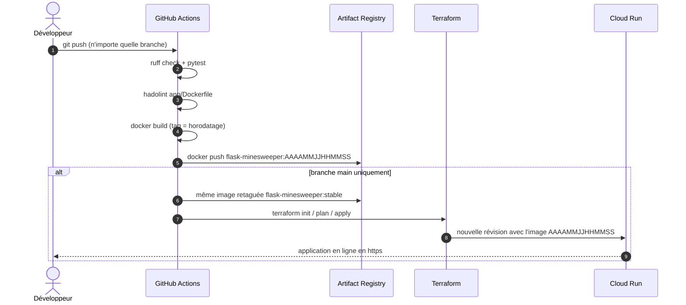

<p align="center"></p>

# coding-dojo-devops

Coding dojo DevOps : on prend une petite application web (un **démineur** en Python/Flask) et on la fait passer
du code source jusqu'à une URL publique en **https** sur Google Cloud, de manière **entièrement automatisée**.

Le but n'est pas le jeu, mais tout ce qu'il y a autour :

* **tester** le code automatiquement (pytest + ruff) ;
* **conteneuriser** une application (Docker) ;
* **vérifier** sa qualité automatiquement (lint du Dockerfile avec hadolint) ;
* **construire et publier** une image à chaque push (GitHub Actions + Artifact Registry) ;
* **décrire l'infrastructure en code** et la déployer (Terraform + Cloud Run).

> Un `git push` sur `main` = une nouvelle version en ligne, sans aucune action manuelle.


Le jeu : trois niveaux, clic pour découvrir, clic droit (ou appui long sur mobile) pour poser un drapeau,
clic sur un chiffre pour découvrir ses voisins quand tous les drapeaux sont posés. Jouable au clavier
(flèches, Entrée, `F`).

## Vue d'ensemble de la stack



| Brique | Rôle |
|---|---|
| **Python / Flask** | L'application : sert la page du démineur sur le port 5000 (le jeu lui-même tourne en JavaScript dans le navigateur). |
| **pytest / ruff** | Tests unitaires et linter Python : le pipeline s'arrête si l'un échoue. |
| **Docker** | Emballe l'application et ses dépendances dans une image exécutable partout. |
| **GitHub Actions** | La CI/CD : exécute le pipeline à chaque push. |
| **hadolint** | Linter de Dockerfile : bloque le pipeline si le Dockerfile ne respecte pas les bonnes pratiques. |
| **Artifact Registry** | Registre privé GCP qui stocke les images Docker. |
| **Terraform** | Infrastructure as Code : décrit le service Cloud Run et ses droits, puis l'applique. |
| **Cloud Storage** | Stocke le *state* Terraform (ce que Terraform a déjà créé) pour qu'il soit partagé. |
| **Cloud Run** | Exécute le conteneur en serverless et l'expose en https. Descend à 0 instance sans trafic, plafonné à 2. |

## Processus de déploiement

Le pipeline est défini dans [`.github/workflows/docker-build-and-terraform.yml`](.github/workflows/docker-build-and-terraform.yml).



* **Toutes les branches** : tests + lint + build + push d'une image taguée avec la date. Ça permet de vérifier que tout
  se construit, sans toucher à la production.
* **Branche `main`** : en plus, l'image est aussi taguée `stable`, puis Terraform déploie sur Cloud Run
  l'image du tag horodaté. Ce tag ne change jamais, donc chaque push crée bien une nouvelle révision
  (avec un tag mobile comme `stable`, Terraform ne verrait aucune différence et ne redéploierait rien).

## Organisation du repo

```text
.
├── app/                     # L'application
│   ├── app.py               # Serveur Flask
│   ├── templates/index.html # Page du jeu (HTML/CSS)
│   ├── static/              # Logique du jeu (JS) et logo
│   ├── tests/               # Tests pytest
│   ├── requirements.txt     # Dépendances Python
│   ├── requirements-dev.txt # Dépendances de test (pytest, ruff)
│   ├── pyproject.toml       # Configuration pytest / ruff
│   ├── Dockerfile           # Construction de l'image
│   └── docker-compose.yml   # Lancement local avec Docker
├── infra/                   # L'infrastructure (Terraform)
│   ├── backend.tf           # State stocké dans un bucket GCS
│   ├── versions.tf          # Versions de Terraform et du provider google
│   ├── provider.tf          # Configuration du provider google
│   ├── variables.tf         # Variables d'entrée
│   ├── env.tfvars           # Valeurs : projet, région, registre
│   ├── main.tf              # Service Cloud Run (plafonné à 2 instances)
│   └── iam.tf               # Accès public (allUsers -> run.invoker)
├── docs/                    # Documentation à publier, capture d'écran
└── .github/workflows/       # Pipeline CI/CD
```

## Prérequis

* Un compte GitHub avec accès au repo.
* Git et Python 3.10+ en local, ou un **GitHub Codespace** (rien à installer).
* Docker, optionnel, pour tester l'image en local.

Aucun accès à la console GCP n'est nécessaire : c'est la CI qui parle à Google Cloud.

## Lancer en local

Sans Docker (Python 3.10+) :

```bash
cd app
pip install --no-cache-dir -r requirements.txt
python app.py
```

Avec Docker :

```bash
cd app
docker compose up --build
```

L'application est accessible sur http://localhost:5000 (ou sur l'URL indiquée par la console dans un GitHub Codespace).

Lancer les tests et le linter (ce que fait la CI) :

```bash
cd app
pip install -r requirements-dev.txt
ruff check .
pytest -v
```

## Configuration GCP

Ces éléments sont créés **à la main une fois pour toutes** (ils ne sont pas gérés par Terraform) :

| Élément | Valeur |
|---|---|
| Projet | `coding-dojo-devops-473609` |
| Région | `europe-west9` (Paris) |
| Bucket du state Terraform | `coding-dojo-devops_tfstate` |
| Repo Artifact Registry | `app` |
| Service account de la CI | `tf-sa-github` |

Secrets GitHub utilisés par le pipeline (*Settings > Secrets and variables > Actions*) :

| Secret | Contenu |
|---|---|
| `GCP_SERVICE_ACCOUNT_KEY` | Clé JSON du service account `tf-sa-github` |
| `GCP_PROJECT_ID` | ID du projet GCP |
| `REGION` | Région GCP |
| `ARTIFACT_REGISTRY_REPO` | Nom du repo Artifact Registry |

## Le dojo

Les exercices sont signalés par des commentaires `TODO` dans le code :

```bash
git grep -n TODO
```

On travaille sur la branche `dojo`. Chaque push déclenche le pipeline (tests, lint, build, push de l'image) :
regardez l'onglet **Actions** de GitHub pour voir ce qui passe... ou casse. Le déploiement sur Cloud Run ne
part que depuis `main`, via une pull request depuis `dojo`.

Règles du jeu :

* jamais de secret ni de clé dans le code : tout passe par les secrets GitHub ;
* un pipeline rouge se répare avant de pousser autre chose ;
* on lit le message d'erreur en entier avant de demander de l'aide.

## Accès

https://flask-minesweeper-28477363719.europe-west9.run.app
