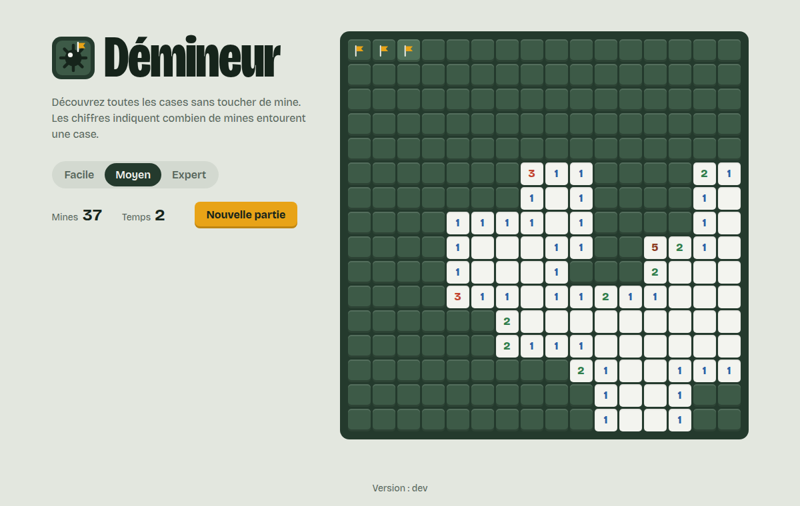

= Démineur : coding dojo DevOps
:toc: left
:toc-title: Sommaire
:icons: font
:source-highlighter: highlight.js
:imagesdir: images

image::logo.svg[Logo,96,align=center]

Une petite application web (un démineur) construite, testée et déployée sur Google Cloud
de manière entièrement automatisée à chaque `git push`.

https://flask-minesweeper-28477363719.europe-west9.run.app[Jouer en ligne] |
https://github.com/antoninBr/coding-dojo-devops[Code source]

== Le jeu

* Clic : découvrir une case.
* Clic droit ou appui long : poser un drapeau.
* Clic sur un chiffre : découvrir ses voisins quand tous ses drapeaux sont posés.
* Clavier : flèches pour se déplacer, kbd:[Entrée] pour découvrir, kbd:[F] pour un drapeau.

== Architecture

[cols="1,3"]
|===
| Brique | Rôle

| Flask + gunicorn | Sert la page du jeu (le jeu tourne en JavaScript dans le navigateur).
| Docker | Image multistage : une étape installe les dépendances, l'image finale ne garde que le nécessaire.
| GitHub Actions | Tests, lint, build et déploiement à chaque push.
| Artifact Registry | Stocke les images Docker.
| Terraform | Décrit le service Cloud Run et ses droits.
| Cloud Run | Exécute le conteneur et l'expose en https (2 instances au maximum).
|===

== Pipeline

. `ruff` et `pytest` vérifient le code Python.
. `hadolint` vérifie le Dockerfile.
. L'image est construite et poussée avec un tag horodaté.
. Sur `main` uniquement : l'image est taguée `stable` et Terraform déploie le tag horodaté sur Cloud Run.

Cette documentation est elle-même générée par un workflow GitHub Actions
(`.github/workflows/docs.yml`) avec Asciidoctor, puis publiée sur GitHub Pages.

== Lancer en local

[source,bash]
----
cd app
docker compose up --build
----

Puis ouvrir http://localhost:5000.
